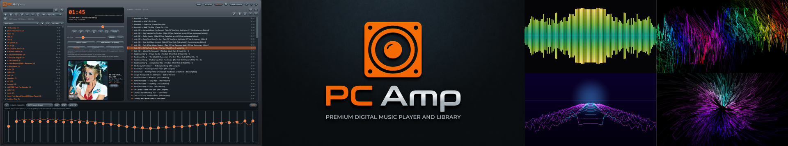

<div align="center">

# PCAmp

### A fast, skinnable music and video player for Windows

Bit-perfect audio, a MilkDrop-style visualizer, huge-library support, and built-in streaming between your PCs.

Miss the good old days of Winamp? The skins, the visualizers, the feeling of owning your music. Those days don't have to be over.
Meet the modern music player you've been waiting for — built for today, inspired by what made Winamp legendary.
A fast, fully skinnable music and video player for Windows, featuring bit-perfect audio, a MilkDrop-style visualizer, support for huge music libraries, and built-in streaming between your PCs.
Your music. Your style. Your player. Just like the good old days.




</div>

## Highlights

| | |
| --- | --- |
| 📚 **Huge libraries** | Built for collections of over 100,000 tracks |
| 🗂️ **Smart sorting** | Keeps a big library organised |
| 🎬 **Video player** | Built-in playback for MP4, MOV and AVI |
| 🔊 **Bit-perfect audio** | WASAPI exclusive mode, up to 32-bit |
| 🎚️ **Equalizer** | 31 bands, with presets |
| 🌊 **Visualizer** | MilkDrop-style engine, 15 styles, and your own custom ones |
| 🌐 **Network streaming** | PCs running PCAmp find each other and play each other's libraries |
| 🎨 **Themes** | Seven built in, or make your own |
| 🧹 **DupFix** | Built-in duplicate track finder |
| 🏷️ **Tag editor** | Edit single tracks or whole folders |

## Library

PCAmp is built for big collections and handles libraries of **over 100,000 tracks**.

- **Smart library sorting** keeps even a huge collection organised
- Organise your library into folders and drag tracks onto them to file them
- Build playlists by dragging tracks in, with repeat and shuffle
- Save playlists as **.m3u8**, so they open in other players too
- Edit tags for the selected tracks, or pick a folder to edit every track in it

## Video

The **built-in video player** plays **MP4, MOV and AVI** files, so you don't need another app. Videos on your other PCs show up over the network too.

## Sound

- **WASAPI exclusive mode** for bit-perfect playback, or **shared mode** through the Windows mixer
- 16-bit, 24-bit and 32-bit output, with the sample rate, bit depth and any resampling shown on screen
- **31-band equalizer** with presets, collapsible when you don't need it
- Seamless Playback with manual gap selection.
## Visualizer

Fifteen built-in styles:

`bars` · `mirror` · `scope` · `radial` · `led` · `starfield` · `warp` · `coaster` · `kaleidoscope` · `plasma` · `tunnel` · `fireworks` · `terrain` · `lava` · `milk`

The **milk** style is a MilkDrop-like flow engine. Each frame, the previous picture is zoomed, twisted and rippled for swirling, morphing visuals that react to your music.

Double-click the analyzer to open the visualizer in its own window, press **F11** for fullscreen, and click to change colours.

### Make your own

Drop a small text file into the **Visualizers** folder (press **O** in the visualizer window to open it) and it appears in the app:

```json
{
  "name": "Ocean Flow",
  "style": "milk",
  "shape": "wave",
  "colors": ["#03045E", "#0077B6", "#00B4D8", "#CAF0F8"]
}
```

The template in the folder lists every option.

## Themes

Built-in themes: **Glass**, **Wood**, **Stereo**, **Console**, **Ember**, **Abyss** and **Brushed**. Press **THEME** to step through them.

To make your own, copy `_Template.xaml` in the Themes folder, rename it, and change the colours. Your theme shows up after the built-in ones and reloads each time you switch to it. Anything you get wrong falls back to Glass.

## Network streaming

Run PCAmp on two or more PCs on the same Wi-Fi or network and they **find each other automatically**. No setup, no IP addresses.

Press **NETWORK** to browse and play the music and videos on your other computers, and let them play yours.

**Use it as a home music server:** keep your whole collection on one main PC, leave it running, and stream it to every other PC in the house.

- Computers appear in the list within a few seconds
- Set an optional **password** to keep your library private. Use the same password on every PC and they connect without asking
- With no password set, anyone on your network can play your library, so set one on shared networks
- Network tracks are play-only: they can't be edited or deleted from the other PC, and they leave your library when you disconnect

> **Firewall:** the first time you run PCAmp, Windows will ask whether to allow it. Choose **Private networks**, or your other PCs won't be able to see it.

## DupFix

Find and clean up duplicate tracks across your collection.

- **Identical files:** exact copies, safe to remove
- **Same song:** same artist and title with about the same length. This also finds copies in other formats and bitrates, so check before deleting
- **Auto-mark** leaves one copy per group: keep the shortest path, oldest, newest or largest file
- Nothing is deleted until you tick files and press **DELETE MARKED**, and files go to the Recycle Bin

## Desktop integration

- Minimise to the **system tray**
- **Start with Windows**, and optionally start in the tray (`Ctrl+,` for preferences)
- Works with your keyboard's **media keys** and the Windows media controls

## Getting started

**Requirements**

- Windows 10 or later (64-bit)
- [.NET 8 Desktop Runtime (x64)](https://dotnet.microsoft.com/download/dotnet/8.0)

**Run it**

1. Download the latest release and unzip it anywhere
2. Run **`PCAmp.exe`**

Keep all the files in the folder together, as `PCAmp.exe` needs the DLLs next to it.

## Keyboard shortcuts

| Key | Action |
| --- | --- |
| `Ctrl` + `,` | Preferences |
| `F11` | Fullscreen visualizer |
| `O` | Open your visualisations folder |
| `Delete` | Remove selected tracks from the playlist |

## Built with

[NAudio](https://github.com/naudio/NAudio) for audio, [TagLib#](https://github.com/mono/taglib-sharp) for tags, and .NET 8 with WPF.
